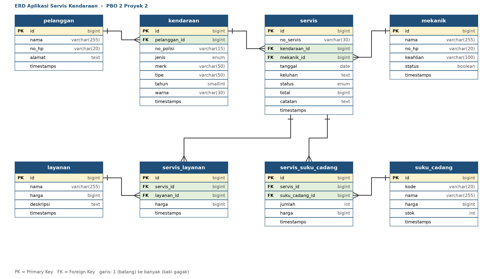

 Alikasi Servis Kendaraan (PBO 2 - Proyek 2)

Aplikasi web manajemen bengkel servis kendaraan (motor dan mobil) berbasis **Laravel 13**, **MySQL**, dan template **AdminLTE 4**.

## Fitur
- Login/logout dan dashboard (jumlah pelanggan, kendaraan, servis berjalan, pendapatan bulan ini, servis terbaru, stok menipis)
- CRUD data master: pelanggan, kendaraan, mekanik, layanan, suku cadang (pencarian dan pagination)
- Transaksi servis: pilih kendaraan, mekanik, layanan, dan suku cadang; total dihitung otomatis
- Stok suku cadang berkurang otomatis, dikembalikan saat servis diubah/dihapus (memakai database transaction)
- Status servis: Menunggu, Dikerjakan, Selesai, Diambil, serta cetak nota

## ERD


File sumber diagram: [docs/ERD-Servis-Kendaraan.drawio](docs/ERD-Servis-Kendaraan.drawio) (dapat dibuka di diagrams.net).

## Kebutuhan
- PHP 8.3, Composer, MySQL (Laragon di Windows)

## Cara menjalankan
```bash
git clone <URL-REPOSITORY>
cd <nama-folder>
composer install
copy .env.example .env        # Windows (Linux/Mac: cp .env.example .env)
php artisan key:generate
```
Buat database `db_pbo2_servis`, lalu atur `.env`:
```
DB_CONNECTION=mysql
DB_HOST=127.0.0.1
DB_PORT=3306
DB_DATABASE=db_pbo2_servis
DB_USERNAME=root
DB_PASSWORD=
```
Salin folder `dist` AdminLTE 4 ke `public/dist`, lalu:
```bash
php artisan migrate:fresh --seed
php artisan serve
```
Buka http://127.0.0.1:8000 dan login:

| Email | Password |
|---|---|
| admin@servis.test | password |

## Struktur utama
- `app/Models` - model dan relasi
- `app/Http/Controllers` - logika dan validasi
- `database/migrations` - struktur 8 tabel
- `database/seeders` - data contoh dan akun admin
- `resources/views` - tampilan Blade (AdminLTE)
- `routes/web.php` - routing

## Catatan
Folder `public/dist` (AdminLTE) tidak ikut dilampirkan jika berukuran besar; unduh dari repository AdminLTE dan letakkan di `public/dist`.
